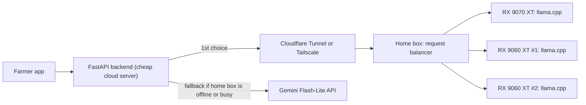

# Self-Hosted AI Plan: Train on Colab, Serve on Your Own AMD GPUs

> [!NOTE]
> This plan is based on general knowledge of these GPUs and tools, not on tests with your machines. Speeds and concurrency numbers are rough estimates. Measure them on your hardware before relying on them.

## Short answer

**Yes, it's possible**, with one rule: **train on Colab, run on your AMD cards.**

- **Training** works best on NVIDIA GPUs, and Colab's GPUs are NVIDIA. Unsloth and most fine-tuning tools are built for NVIDIA first. Training on AMD is possible but rougher to set up, so don't train at home.
- **Running the model (inference)** works on AMD. llama.cpp supports AMD cards through its Vulkan or ROCm backends, and Ollama is built on llama.cpp. The RX 9000 series is supported in recent ROCm releases on Linux, but check the exact version against your cards. Vulkan avoids most ROCm setup trouble.

## Your hardware

| Card | VRAM | What fits (4-bit quantized model files) |
|---|---|---|
| RX 9060 XT ×2 | 16 GB *or* 8 GB (two versions of this card exist; check which you have) | 16 GB: 7–8B models easily, up to ~14B. 8 GB: 7–8B only, short context. |
| RX 9070 XT | 16 GB | 7–8B models easily (even at 8-bit), up to ~14B |

Rough model sizes: an 8B model is about 5 GB at 4-bit and about 8.5 GB at 8-bit; a 14B model is about 9 GB at 4-bit. Leave 2–4 GB free for context and the cache.

**Rough speed for one 8B 4-bit model per card:** about 40–90 tokens/s for a single user, and about 4–8 users at the same time per card. That's enough for an early-stage app, not for thousands of users at once.

**Best way to use 3 cards:** run **one copy of the model per card** and spread requests across them. That gives about 3× the capacity and keeps working if one card fails. Only split a model across cards if it's too big for one.

## Architecture: hybrid with automatic fallback

- The backend checks the home GPU endpoint first, with a short timeout. If the box is offline, overloaded or slow, the request goes to Gemini Flash-Lite. Users never see an outage.
- To scale, add another card or box behind the balancer, or let more traffic spill over to Gemini. No code changes needed.
- llama.cpp's server offers an **OpenAI-compatible API**, so the backend needs only one small client that switches between the two providers.

## Pipeline: Colab → home GPUs

1. **Colab (NVIDIA GPU):** fine-tune a 7–8B model (e.g. Qwen or Llama) with Unsloth and LoRA. Save checkpoints to Google Drive and auto-shutdown at the end (`runtime.unassign()`). Budget about 15–30 units.
2. **Export:** merge the LoRA adapter into the model, then convert to **GGUF** (llama.cpp's file format) at Q4_K_M or Q5_K_M. Unsloth can export GGUF directly.
3. **Download** the GGUF file from Drive to the home box.
4. **Serve:** run one `llama-server` per card (Vulkan or ROCm build), each pinned to its own GPU and port. Put nginx or LiteLLM in front to balance requests.
5. **Expose safely:** use Cloudflare Tunnel or Tailscale. Don't open router ports. Require an API key between the backend and the home box.

## What to self-host vs. keep on Gemini

| Task | Where | Why |
|---|---|---|
| Crop-disease image check | Small classifier (ONNX), on CPU or a GPU | Tiny, fast, and doesn't need an LLM |
| Assistant chat (the 1-by-1 questions), JSON extraction, classification | **Home GPUs**, fine-tuned 8B | Narrow, repetitive tasks are where fine-tuned small models do well |
| Embeddings (384-dim) | Home GPU or CPU | Cheap; matches `VECTOR_DIMENSION=384` |
| Hard or open-ended questions, home box offline | Gemini Flash-Lite | Fallback and safety net |

## Risks to accept

> [!WARNING]
> Home hosting means **your power and internet are your uptime.** Power cuts, ISP outages and Windows updates will take the box down. That's why the Gemini fallback is required.

- **Electricity:** the cards draw roughly 150–300 W each under load. Turn on power limits or undervolting.
- **Linux works best:** ROCm and llama.cpp on AMD work best on Ubuntu. Windows works with the Vulkan build.
- **Hindi, Marathi and Punjabi quality:** small models are weaker in Indic languages. Include Indic examples in the training data, and test before switching traffic over.

## Can Colab or Cloud Run serve the model?

| Option | Good for | Verdict |
|---|---|---|
| **Colab as a server** | — | ❌ No. Colab's rules don't allow running a web service; sessions end after 24 h at most; and it uses up compute units every minute it's on (a T4 at about 2 units/hour would use all 200 units in about 4 days). **Use it for training only.** |
| **Cloud Run, CPU only** (scales to zero) | Image classifier (ONNX), 384-dim embedding model, very small LLMs (0.5–1.5B, slow) | ✅ Cheap, and free when idle |
| **Cloud Run with an NVIDIA L4 GPU** (scales to zero) | An 8B fine-tuned LLM | ⚠️ Very roughly ₹60–90/hour while running (check Google's current pricing). An idle instance can keep billing for several minutes after the last request, and the model takes time to load on each cold start. Always-on would be about ₹45–60k/month. Only worth it with steady traffic. |
| **Gemini Flash-Lite API** | Everything, at low or uneven traffic | ✅ Pay per call; usually the cheapest until usage is high |
| **Your home AMD GPUs** | 8B LLM serving | ✅ Almost free per request; uptime is the risk |

**Best mix:** Colab = training only. Cloud Run CPU = classifier + embeddings. Home GPUs = main LLM. Gemini Flash-Lite = fallback. Consider Cloud Run GPU only once traffic stays steady all day.

## Option: run the model on the farmer's phone (on-device)

Every user's phone does the work, so **you pay nothing per request and capacity grows with your users**. It also works offline.

**Candidate models (4-bit):** Gemma 3 1B (~0.6 GB), Qwen3 1.7B (~1.2 GB), Gemma 3n E2B / E4B (built for phones, can also take images and audio input, ~2–3 GB of memory), Qwen3 4B / Gemma 3 4B (~2.5 GB). Check exact sizes for each model.

**Ways to run it:**

| Runtime | Where | Phone chip used |
|---|---|---|
| MediaPipe LLM Inference / LiteRT-LM (Google) | Android, iOS, **web** | CPU or GPU (NPU on some phones) |
| WebLLM (MLC) | **web (PWA)** via WebGPU | GPU |
| llama.cpp (Android build) | Native app | CPU or GPU |
| Qualcomm AI Hub / QNN, Apple Core ML | Native app | **NPU** |

> [!WARNING]
> **NPU:** a web app/PWA can't use the phone's NPU yet (WebNN is still early); in the browser you get the GPU only. Using the NPU needs a **native wrapper** (e.g. Capacitor) and code specific to each chip maker. **Low-end phones:** many farmers have 3–4 GB RAM phones, and a 4B model (~2.5 GB) won't run well there. A 2–3 GB download over mobile data is also a big ask.

**Training:** fine-tune the small model on Colab with Unsloth (a 1–4B model needs only a few units on a T4/L4), then export to GGUF (llama.cpp) or the MediaPipe/LiteRT format.

**Tiered plan:**
1. **All phones:** small crop-disease classifier on the phone (~5–20 MB) → instant, offline diagnosis.
2. **Capable phones (≥6–8 GB RAM, WebGPU available):** optional "Offline AI" download over Wi-Fi of a fine-tuned 1–4B model for the assistant.
3. **Everyone else / hard questions:** the server (home GPUs → Gemini Flash-Lite fallback).

## Flagship-phone plan: crop expert + animal (Pashu) expert, on-device

**Target phones:** 12–16 GB RAM (Snapdragon 8 Gen 2/3, Dimensity 9000+, recent Pixel/Samsung/OnePlus). A 4B model at 4-bit takes about 2.5–3 GB, so it fits comfortably.

> [!NOTE]
> **Decision (marked for now): new flagship phones → Gemma 4 E4B (the 4B size).** Use Gemma 4 E4B (4-bit, roughly 2.5–3 GB) as the on-device base model for flagships. Before training, confirm the exact model name and file size, the runtime (MediaPipe / LiteRT-LM or llama.cpp), and its tool-calling support. Other phones keep the tiered plan: Gemini Nano where available, otherwise the cloud.
> **Target chip (marked): Snapdragon on Samsung Galaxy.** Checked 2026-11-20 against Qualcomm's AI Hub model cards:
> - **Gemma 4 E4B** (the 4B-class Gemma 4) is officially listed for *Snapdragon 8 Elite / 8 Elite Gen 5 for Galaxy*, at about 13–18 tokens/s. But its runtime is `GENIEX_LLAMACPP`, and the card doesn't say whether that uses the NPU.
> - **Qwen3-4B-Instruct-2507** (the current base in notebook 03) is listed on the Genie / QAIRT NPU path, at about 27 tokens/s on 8 Elite for Galaxy and 28 on 8 Elite Gen 5 (4K context).
> - Both cards say you can export *custom fine-tuned weights* with `qai-hub-models`. The exact command isn't confirmed yet.
> - Phone needs: Android 15+, Hexagon v73+, 12 GB+ RAM for 3B+ models.
> - Export host: Linux, Windows or macOS, Python 3.10, "significant RAM + swap", about 2–3 h. **Colab isn't confirmed for this step**, so use a high-RAM Linux PC or cloud VM. Training stays on Colab.
> - Fallback for non-Snapdragon phones: a GPU/CPU build (LiteRT-LM or llama.cpp).
> 
> **Gemma 4 E4B export page checked (2026-11-20, qualcomm/ai-hub-models `gemma_4_e4b_it`):**
> - The true NPU path (w4a16 on Genie/QAIRT) is **disabled by Qualcomm**. Its `manifest.yaml` records an on-device accuracy failure ("Device accuracy (0.0 %) deviates from benchmark (98.2 %)") and calls it a developer preview with known issues.
> - The path Qualcomm ships is **llama.cpp q4_0 GGUF** (GenieX llama.cpp plugin). On the Galaxy S26 at 512 context it measures CPU 18.2, GPU 17.3 and NPU 18.6 tokens/s, so the NPU adds little. The Galaxy S25 measures about 15 tokens/s.
> - Custom weights: `python -m qai_hub_models.models.gemma_4_e4b_it.quantize --checkpoint <dir> ...`. This needs a CUDA GPU, Python 3.11+, and about **120 GB RAM+swap** on the host. **That doesn't fit on Colab.**
> - **Decision:** fine-tune Gemma 4 E4B on Colab (notebook 03 — switched 2026-11-20), export F16 GGUF then `llama-quantize` to **Q4_0**, and run it with llama.cpp on the phone (CPU/GPU). Skip the NPU export for Gemma 4 until Qualcomm enables w4a16. If a real NPU build is needed later, Qwen3-4B-Instruct-2507 (Genie w4a16 enabled, about 27 tokens/s on 8 Elite) is the candidate. Its custom-weight export requirements aren't checked yet.

**Structure: one base model + two small adapters** (rather than two full models):

| Part | Size | Purpose |
|---|---|---|
| Base 4B model (Gemma 3 4B / Gemma 3n E4B / Qwen3 4B), 4-bit | ~2.5–3 GB, downloaded once | Language (EN/HI/MR/PA), reasoning |
| Crop LoRA adapter | ~50–150 MB | Diseases, fertilizer, sowing schedules, soil, schemes |
| Pashu LoRA adapter | ~50–150 MB | Breeds, diet plans, vaccination, diseases, sale-listing interview |
| On-device knowledge DB (SQLite + 384-dim embeddings) | ~20–200 MB | Exact facts: dosages, prices, schemes, vet contacts |

> [!IMPORTANT]
> **Fine-tuning teaches the model *how* to answer: tone, language, question flow, JSON output. It doesn't reliably store *facts*.** Facts that are only trained in get made up under pressure (e.g. a wrong pesticide dose). Keep exact facts in the small on-device knowledge DB, and have the model look them up (local search) before answering. Update facts by syncing the DB; no retraining needed.

**Simpler start:** train **one** 4B model on crop + animal data together, and switch modes with the system prompt. Split into two adapters only if quality drops. llama.cpp supports loading LoRA adapters at runtime; MediaPipe supports LoRA for some Gemma models (check which).

**Colab cost:** 4B LoRA fine-tune on an L4 takes about 2–4 h, roughly **5–10 units per run**. Plan 3–4 runs per expert: about 40–80 units in total.

## Design decision: small model + tools (not a big "know-everything" model)

The model doesn't store knowledge; **your APIs and DB are its tools**. The model only has to: understand the farmer (EN/HI/MR/PA), ask the next question, pick the right tool + arguments (JSON), and explain the result simply. That job fits a **3–4B model** well.

| Tool type | Example tools | Works offline? |
|---|---|---|
| On-device | `search_knowledge` (local SQLite + embeddings), `classify_crop_photo` (TFLite), `livestock_diet_calc`, `create_listing_draft` | ✅ |
| Backend API | `mandi_price`, `weather_forecast`, `soil_health_card`, `find_vet`, `schemes_lookup` | ❌ (cached last result shown offline) |

**Quantization choice** (rough guidance; benchmark on your own test set):

| Option | Size | Verdict |
|---|---|---|
| 3–4B @ **Q4_K_M** | ~2–2.5 GB | ✅ **Recommended.** Best quality for the size; tool-call JSON stays reliable |
| 3–4B @ Q3 / IQ3 | ~1.6–2 GB | OK for mid-range phones; test JSON reliability |
| 6–8B @ Q2 / IQ2 | ~2.5–3 GB | ❌ 2-bit damages small/mid models badly (broken JSON, weak Hindi/Marathi/Punjabi). 2-bit is only reasonable for very large (70B+) models |
| 6–8B @ Q4 | ~4–5 GB | Possible on 16 GB phones, but slower and hotter; little gain once tools supply the facts |

**Candidate base models with good tool calling:** Qwen3 4B / 1.7B (built-in tool calling), Llama 3.2 3B, Gemma 3 4B.

**Distillation becomes tool-call distillation:** Gemini (teacher) solves farmer questions **using the real tools**; we record the full trace (question → tool call → real tool result → final answer), check it (schema-valid JSON, answer matches the tool output, numbers not invented), and fine-tune the 3–4B student on the traces that pass.

## Next steps

1. Confirm whether your RX 9060 XT cards are **16 GB or 8 GB**, and which OS the box runs.
2. I add an **LLM provider switch** to the backend: home endpoint first, then Gemini fallback, with health checks and timeouts.
3. I write the **Colab fine-tune + GGUF export notebook**.
4. I write the **home box setup**: llama.cpp (Vulkan) on 3 cards + a request balancer + Cloudflare Tunnel, as a single `docker-compose.yml`.
